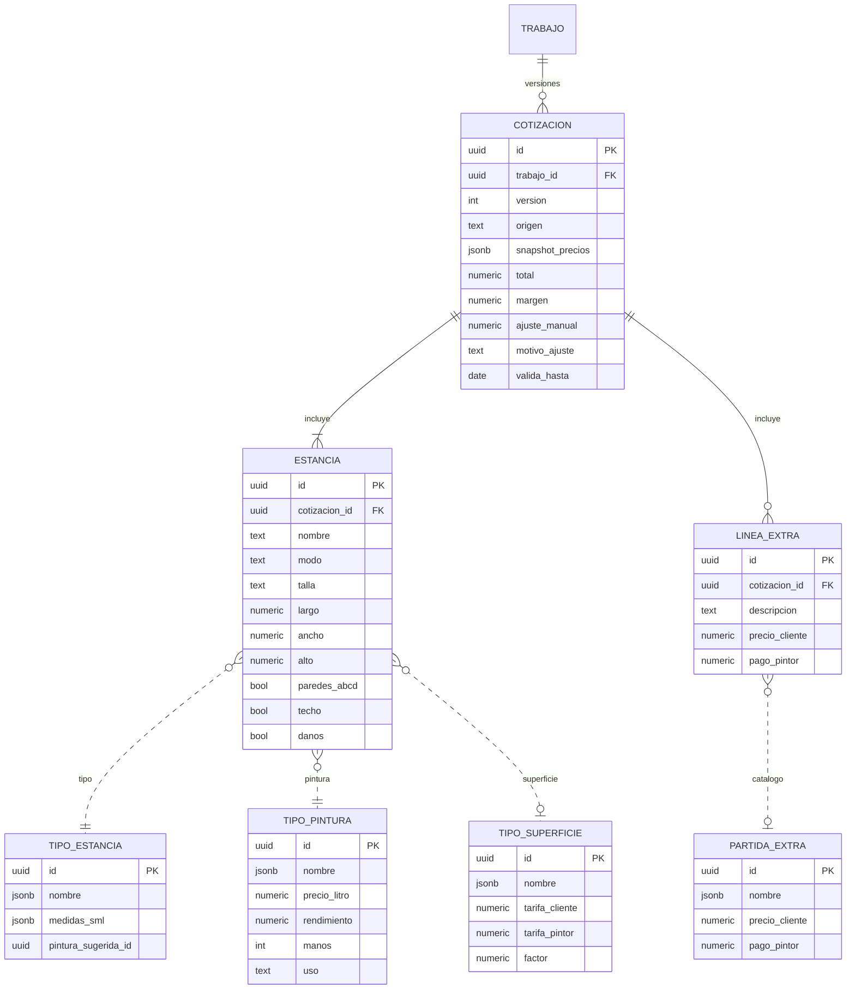
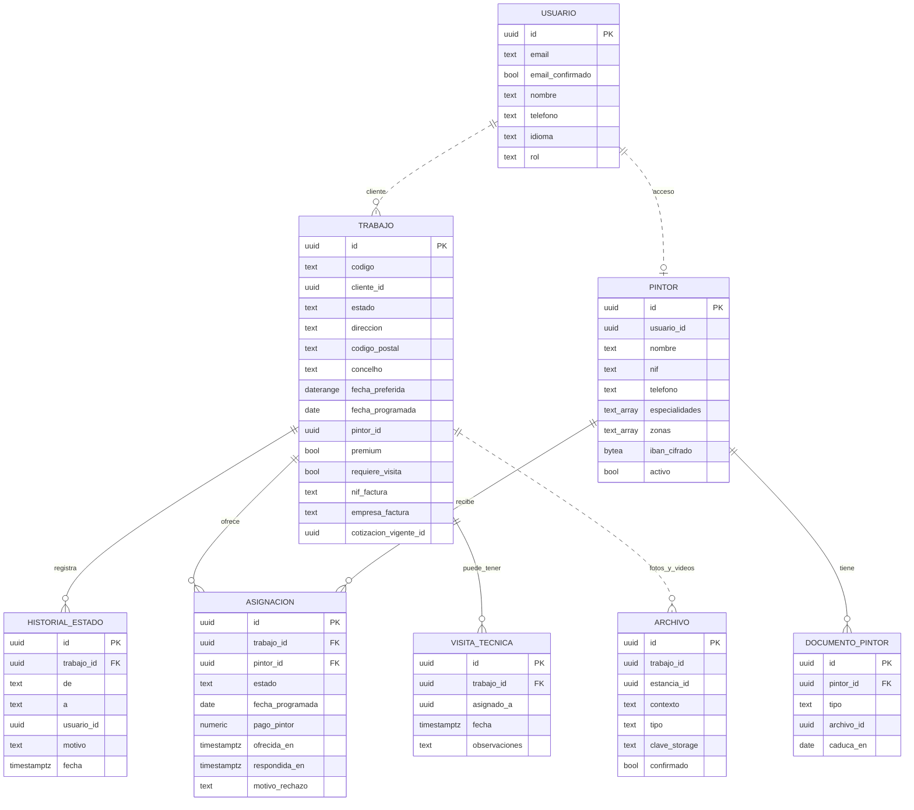
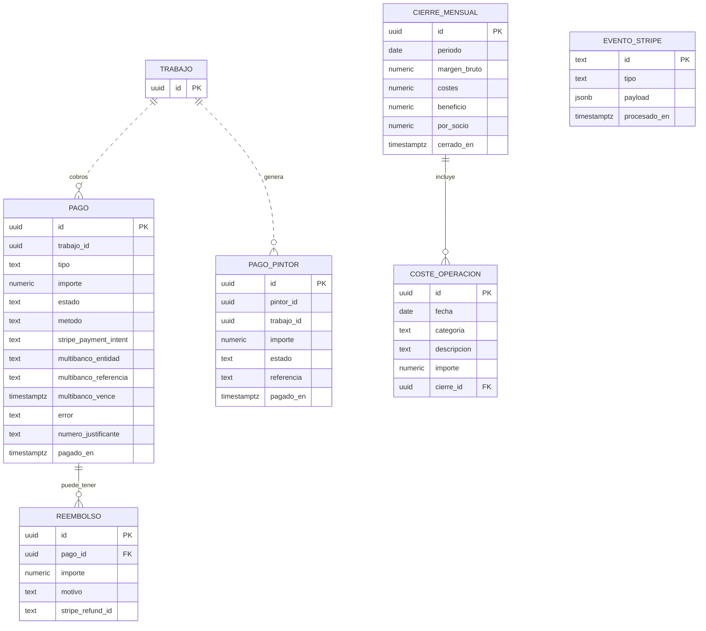

# Pinta — Fase 5.3: Modelo de Datos

> Fuente: documento 5.3 del PRD de Pinta (https://claude.ai/artifact/2kit1XZofSVHccZArkik82). Si este archivo y el documento difieren, manda el documento.

La base de datos es un único PostgreSQL con un esquema por módulo y sin claves foráneas entre esquemas. La pieza central es el trabajo, que tiene varias versiones de cotización, cada una con una copia congelada de los precios del momento.

## Convenciones

Los nombres de tablas y columnas de los diagramas son descriptivos en español; en el código y la base de datos se escribirán en inglés.

| Tema | Convención |
| --- | --- |
| Identificadores | UUID v7 (ordenables por fecha). Los códigos visibles como PT-2026-0142 son un campo aparte |
| Dinero | `numeric(12,2)` en la base de datos, `decimal` en C#. Nunca `float` |
| Fechas | `timestamptz` en UTC; conversión a la hora de Lisboa en la interfaz |
| Textos traducibles del catálogo | `jsonb` con `{pt, es, en}` |
| Catálogo | No se borra: se desactiva con `activo = false`, porque las cotizaciones antiguas lo siguen referenciando |
| Auditoría | `creado_en`, `actualizado_en`, `actualizado_por` en todas las tablas |
| Entre módulos | Referencias solo por ID, sin claves foráneas entre esquemas; integridad garantizada por el código |
| Datos sensibles | IBAN del pintor cifrado con Data Protection de ASP.NET Core; nunca se devuelve completo |
| Estados y tipos | Texto con restricción `CHECK` de valores permitidos |

## Precios y cotización

Un trabajo tiene varias versiones de cotización: la estimación del cliente, la revisada por el admin, la que sale de la visita técnica y la recotización si expira. Cada versión guarda en `snapshot_precios` la configuración completa del momento, así que cambiar tarifas nunca altera un precio ya confirmado. Las líneas punteadas son referencias entre módulos.

**Otras tablas del módulo Precios:**

| Tabla | Contenido |
| --- | --- |
| Modificador | Grupo (ocupación), clave, nombre traducible, factor |
| Configuración global | Una fila: mínimo, máximo, umbral Premium, rango mostrado, % señal, validez, desperdicio, IVA, precio de visita y si es descontable, plazo de revisión, política de cancelación, margen mínimo, visibilidad del teléfono |
| Zona de cobertura | Prefijo de código postal (4 dígitos), concelho, activo |

La superficie suelta es una estancia con `modo = superficie` y un tipo de superficie. El borrador del cliente no se guarda en la base de datos hasta que envía la solicitud: vive en su dispositivo.

## Trabajos, pintores, archivos e identidad

El trabajo guarda su estado actual y un historial de cada cambio. La asignación es una tabla aparte porque un pintor puede rechazarla y el trabajo se ofrece a otro.

- **Usuario** es el usuario de ASP.NET Core Identity, ampliado con nombre, teléfono e idioma. Las tablas internas de Identity (roles, logins externos, tokens) no se muestran.
- **Archivo.contexto** distingue fotos del cliente, de la visita técnica y del resultado final.
- **Trabajo.estado** solo cambia a través de la máquina de estados, que escribe cada cambio en el historial.

## Pagos, finanzas y notificaciones

Cada cobro (señal, resto o visita) es un pago separado ligado a su Payment Intent de Stripe. Los eventos de Stripe se guardan con su propio ID como clave primaria, así que un webhook repetido se detecta y se ignora.

- **Pago.tipo:** señal, resto o visita técnica. **Pago.metodo:** tarjeta, MB WAY o Multibanco. **Pago.estado:** pendiente, requiere acción (Multibanco a la espera), pagado, fallido, cancelado, reembolsado (total o parcial). **Pago.numero_justificante:** `SIM-AAAA-NNNN`, se asigna al pagarse; el PDF se genera al pedirlo a partir de los datos guardados.
- **Trabajo.fecha_programada:** en H5 la fija el admin al pasar a «Programado»; la política de reembolso cuenta los días hasta ella.
- **Coste de operación.categoría** usa la lista cerrada del acuerdo de socios: infraestructura, comisiones de pago, facturación y contabilista, seguro, marketing.
- **Cierre mensual:** el reparto 50/50 se calcula en vivo, pero al cerrar un mes queda congelado. Un coste registrado tarde no cambia lo ya repartido.
- **Notificaciones** solo tiene una tabla de registro de emails enviados: destinatario, plantilla, idioma, estado y fecha.

## Estados del trabajo y transiciones

Esta tabla es la especificación de la máquina de estados: cualquier transición que no aparezca aquí la rechaza el código. El diagrama del flujo está en [Fase 2: Motor de Cotización](https://claude.ai/artifact/FjcgXBnGyGm9cN3jpSG14R).

| De | A | Quién | Condición o efecto |
| --- | --- | --- | --- |
| (nuevo) | Pendiente de email | Cliente | Envía la solicitud sin email confirmado |
| (nuevo) o Pendiente de email | En revisión | Cliente / sistema | Email confirmado; empieza el plazo de 2 días laborables |
| En revisión | Visita técnica | Admin | Asigna visita a un pintor o al socio, con fecha |
| Visita técnica | En revisión | Pintor / socio | Envía medidas reales, fotos y observaciones |
| En revisión | Precio confirmado | Admin | Crea la versión confirmada; empieza la validez de 15 días |
| En revisión | Rechazado | Admin | Motivo obligatorio; email al cliente |
| Precio confirmado | Señal pagada | Sistema | Webhook de Stripe con pago correcto |
| Precio confirmado | Expirado | Sistema | Pasa la validez sin pago (tarea diaria) |
| Expirado | En revisión | Cliente | Pide recotización; se crea una nueva versión |
| Señal pagada | Programado | Admin / Pintor | Pintor asignado y aceptado, fecha fijada: el pintor al aceptar la oferta, o el admin a mano con fecha |
| Programado | En curso | Pintor | Marca el inicio del trabajo |
| En curso | Finalizado | Pintor | Al menos una foto del resultado; se pide el resto al cliente |
| Finalizado | Cerrado | Sistema | Webhook de Stripe con el resto pagado; se genera el pago al pintor |
| Cualquiera antes de En curso | Cancelado | Cliente / admin | Reembolso de la señal según la política: 100% hasta 7 días antes, 50% después |

Cada transición escribe una fila en el historial (quién, cuándo, motivo) y publica un evento interno que dispara emails y pagos.
